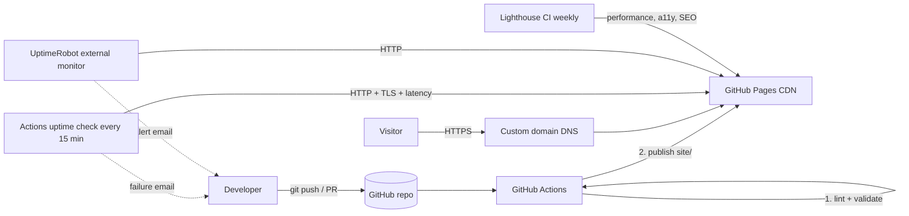

# Cloud-Based Static Website Deployment


**Cognevance Technologies | Cloud Computing & DevOps | Level 1 (Easy)**
**Author:** YOUR NAME | **Live site:** https://YOUR_DOMAIN | **Fallback URL:** https://USERNAME.github.io/cognevance_static-website-deployment/

A responsive static website built with HTML, CSS and JavaScript, hosted on **GitHub Pages**, delivered through a **GitHub Actions** pipeline, secured with **HTTPS and security headers**, served on a **custom domain**, and monitored for **uptime and performance**.

---

## Table of contents
1. [Project overview](#1-project-overview)
2. [Architecture](#2-architecture)
3. [Cloud services used](#3-cloud-services-used)
4. [Repository structure](#4-repository-structure)
5. [Website features](#5-website-features)
6. [Run locally](#6-run-locally)
7. [Deployment process (step by step)](#7-deployment-process-step-by-step)
8. [Custom domain and HTTPS](#8-custom-domain-and-https)
9. [Security configuration](#9-security-configuration)
10. [Version control workflow](#10-version-control-workflow)
11. [Monitoring: uptime and performance](#11-monitoring-uptime-and-performance)
12. [Alternative hosting: Netlify and AWS S3](#12-alternative-hosting-netlify-and-aws-s3)
13. [Troubleshooting](#13-troubleshooting)
14. [Task completion checklist](#14-task-completion-checklist)
15. [Deliverables](#15-deliverables)
16. [Screenshots](#16-screenshots)
17. [Setup checklist before submitting](#17-setup-checklist-before-submitting)
18. [Lessons learned and future improvements](#18-lessons-learned-and-future-improvements)

---

## 1. Project overview
| Item | Detail |
|---|---|
| Goal | Deploy a static website on a cloud platform with proper hosting and monitoring |
| Site | Responsive Cloud & DevOps portfolio (single page + custom 404) |
| Hosting | GitHub Pages (global CDN, free TLS) |
| CI/CD | GitHub Actions: lint, validate, deploy on every push to `main` |
| Domain | Custom domain with enforced HTTPS |
| Monitoring | 15-minute uptime checks, response-time threshold, weekly Lighthouse audit, UptimeRobot |

## 2. Architecture



## 3. Cloud services used
| Service | Purpose |
|---|---|
| GitHub | Source control, issues, pull requests |
| GitHub Pages | Static hosting, CDN, free managed HTTPS certificate |
| GitHub Actions | Validation, deployment, scheduled monitoring |
| DNS provider (your registrar or Cloudflare) | Custom domain records |
| UptimeRobot (free) | Independent external uptime monitoring and alerts |
| Lighthouse CI | Automated performance, accessibility, best-practice and SEO scoring |

## 4. Repository structure
```
cognevance_static-website-deployment/
├── site/                         # Everything published to the web
│   ├── index.html                # Main page
│   ├── 404.html                  # Custom error page
│   ├── css/style.css             # Responsive styles, dark mode
│   ├── js/main.js                # Menu, theme toggle, form validation, reveal, load time
│   ├── assets/favicon.svg
│   ├── robots.txt  sitemap.xml   # SEO
│   ├── CNAME                     # Custom domain for GitHub Pages
│   └── .nojekyll
├── deploy/
│   ├── netlify.toml              # Netlify config incl. security headers
│   └── s3-bucket-policy.json     # AWS S3 + CloudFront alternative
├── .github/workflows/
│   ├── deploy.yml                # Lint + deploy to GitHub Pages
│   ├── uptime.yml                # 15-minute uptime/latency/TLS check
│   └── lighthouse.yml            # Weekly performance audit
├── docs/
│   ├── REPORT.md                 # Project report
│   └── screenshots/              # Evidence images
├── lighthouserc.json             # Lighthouse score budgets
├── .htmlhintrc                   # HTML lint rules
├── LICENSE  .gitignore  README.md
```

## 5. Website features
- **Responsive layout**: CSS Grid/Flexbox, fluid type with `clamp()`, breakpoint at 820px, hamburger menu on mobile.
- **Dark / light theme**: follows OS preference, remembers the visitor's choice.
- **Accessibility**: skip link, semantic landmarks, ARIA labels, visible focus, reduced-motion support, colour contrast.
- **JavaScript**: mobile menu, theme toggle, scroll-reveal animations, page-load timing display, contact form validation.
- **Performance**: no frameworks or external requests, one CSS and one JS file, system fonts, SVG favicon.
- **SEO**: meta description, Open Graph tags, `robots.txt`, `sitemap.xml`.

## 6. Run locally
No build step needed.
```bash
git clone https://github.com/USERNAME/cognevance_static-website-deployment.git
cd cognevance_static-website-deployment/site
python3 -m http.server 8080      # or: npx serve .
# open http://localhost:8080
```
Test responsiveness in browser DevTools (Ctrl+Shift+M) at 375px, 768px and 1280px.

## 7. Deployment process (step by step)

### 7.1 Create the repository and push
```bash
git init
git branch -M main
git add .
git commit -m "feat: initial static website and CI/CD workflows"
git remote add origin https://github.com/USERNAME/cognevance_static-website-deployment.git
git push -u origin main
```

### 7.2 Enable GitHub Pages with Actions
1. Repo **Settings > Pages**.
2. Under **Build and deployment > Source**, choose **GitHub Actions**.
3. Push any commit (or run **Actions > Validate and Deploy > Run workflow**).
4. When the workflow finishes, the URL appears in the run summary and in Settings > Pages.

### 7.3 What the pipeline does (`deploy.yml`)
| Stage | Action |
|---|---|
| validate | HTMLHint lint, required-file check, JavaScript syntax check |
| deploy | Upload `site/` as a Pages artifact, deploy with `actions/deploy-pages` |
Pull requests run validation only; deployment happens only on `main`.

### 7.4 Rollback
Revert the bad commit (`git revert <sha> && git push`); the pipeline redeploys the previous version in about a minute.

## 8. Custom domain and HTTPS

1. Buy or use a domain (a free one such as a student-pack domain is fine).
2. Put your domain in `site/CNAME` (one line, e.g. `www.example.com`) and commit.
3. In your DNS provider add the records:

| Type | Host | Value |
|---|---|---|
| A | `@` | 185.199.108.153 |
| A | `@` | 185.199.109.153 |
| A | `@` | 185.199.110.153 |
| A | `@` | 185.199.111.153 |
| AAAA | `@` | 2606:50c0:8000::153 / 8001::153 / 8002::153 / 8003::153 |
| CNAME | `www` | `USERNAME.github.io` |

4. Repo **Settings > Pages > Custom domain**: enter the domain and save. Wait for the DNS check to pass (minutes to a few hours).
5. Tick **Enforce HTTPS**. GitHub issues and renews a free Let's Encrypt certificate automatically.
6. Verify:
   ```bash
   dig YOUR_DOMAIN +short
   curl -I https://YOUR_DOMAIN
   ```
7. Replace every `YOUR_DOMAIN` placeholder in `site/CNAME`, `site/robots.txt`, `site/sitemap.xml` and set the repository variable `SITE_URL` (see section 11).

> Verify the A/AAAA addresses against GitHub's current documentation ("Managing a custom domain for your GitHub Pages site") when you configure DNS, as providers occasionally change them.

## 9. Security configuration
| Control | Implementation |
|---|---|
| HTTPS everywhere | GitHub Pages "Enforce HTTPS" with managed certificate |
| HSTS | Sent automatically by GitHub Pages on HTTPS-enforced sites; explicit header in `deploy/netlify.toml` for Netlify |
| Content Security Policy | `<meta http-equiv="Content-Security-Policy">` in each page: only same-origin scripts and styles, no inline code, `object-src 'none'` |
| No inline scripts or styles | All code in external files, so CSP can stay strict |
| Referrer policy | `strict-origin-when-cross-origin` meta tag |
| Clickjacking | `X-Frame-Options: DENY` and `frame-ancestors 'none'` on Netlify (response headers are not configurable on GitHub Pages) |
| No secrets in repo | `.gitignore`, no keys or tokens; workflows use least privilege `permissions` |
| Branch protection | Recommended: require pull request + passing "validate" check on `main` |
| Dependency surface | Zero third-party runtime dependencies |
| Account security | 2FA enabled on GitHub and DNS provider |
| Third-party actions | Official `actions/*` and well-known actions pinned to major versions; Dependabot can be enabled for Actions updates |

Verify headers and grade after deployment with https://securityheaders.com and https://www.ssllabs.com/ssltest/ and save the screenshots.

## 10. Version control workflow
- **Branching:** `main` is always deployable; work happens on `feature/<name>` branches and merges via pull request.
- **Commit convention:** Conventional Commits: `feat:`, `fix:`, `docs:`, `style:`, `ci:`, `chore:`.
- **Suggested history to show:**
  ```text
  feat: add responsive layout and navigation
  feat: add dark mode and form validation
  ci: add GitHub Pages deployment workflow
  ci: add uptime and Lighthouse monitoring
  docs: add README, report and screenshots
  ```
- **Tags/releases:** `git tag -a v1.0.0 -m "Level 1 submission" && git push origin v1.0.0`.

## 11. Monitoring: uptime and performance

### 11.1 Layer 1: GitHub Actions uptime check (`uptime.yml`)
Runs every 15 minutes and fails (triggering GitHub's failure email) if:
- HTTP status is not 200
- TLS certificate verification fails
- Total response time exceeds 3 seconds

It prints status code, total time, connect time and time-to-first-byte in the log, and warns if the HSTS header is missing.
**Setup:** Settings > Secrets and variables > Actions > **Variables** > New variable `SITE_URL` = `https://YOUR_DOMAIN`.
(GitHub scheduled runs can be delayed during busy periods, so treat 15 minutes as approximate.)

### 11.2 Layer 2: External monitor (UptimeRobot)
1. Create a free account at https://uptimerobot.com.
2. Add monitor: type **HTTP(s)**, URL `https://YOUR_DOMAIN`, interval 5 minutes.
3. Add your email as alert contact.
4. Optional: create a public status page and put its link in this README.
5. Screenshot the dashboard showing uptime percentage and response-time graph.

### 11.3 Layer 3: Performance audit (`lighthouse.yml`)
Runs Lighthouse on every push to `main` and weekly. Budgets in `lighthouserc.json`: Performance >= 90 and Accessibility >= 90 (fail), Best Practices and SEO >= 90 (warn). Reports are uploaded as artifacts and to temporary public storage; the report link is shown in the run log.
You can also run it manually: Chrome DevTools > Lighthouse, or https://pagespeed.web.dev.

### 11.4 In-page performance indicator
The page shows its own load time using the browser Navigation Timing API (`#loadTime`).

### 11.5 Results (fill in after deployment)
| Metric | Target | Measured |
|---|---|---|
| Uptime (first 7 days) | >= 99.9% | _ |
| Avg response time | < 500 ms | _ |
| Lighthouse Performance | >= 90 | _ |
| Lighthouse Accessibility | >= 90 | _ |
| Lighthouse Best Practices | >= 90 | _ |
| Lighthouse SEO | >= 90 | _ |
| SecurityHeaders.com grade | B or better | _ |
| SSL Labs grade | A | _ |

## 12. Alternative hosting: Netlify and AWS S3

**Netlify:** Add new site > Import from GitHub > publish directory `site` (or move `deploy/netlify.toml` to the repo root). Headers in the file apply automatically. Domain and HTTPS are configured under Domain management.

**AWS S3 + CloudFront:**
```bash
aws s3 mb s3://YOUR_BUCKET_NAME --region ap-south-1
aws s3 sync site/ s3://YOUR_BUCKET_NAME --delete
# Create a CloudFront distribution with Origin Access Control, default root object index.html,
# then attach deploy/s3-bucket-policy.json to the bucket (replace the placeholders).
```
Keep the bucket private and serve through CloudFront for HTTPS; add the custom domain with an ACM certificate (issued in us-east-1).

## 13. Troubleshooting
| Problem | Fix |
|---|---|
| Pages shows 404 | Settings > Pages > Source must be **GitHub Actions**; confirm the workflow succeeded |
| Custom domain "DNS check unsuccessful" | Re-check records, wait for propagation (`dig`), remove conflicting old records |
| "Enforce HTTPS" is greyed out | Certificate still being issued; wait up to an hour after DNS check passes |
| CSS/JS not loading on a project URL | Use relative paths (already done); avoid leading `/` for the main page |
| Uptime workflow fails: "Set repository variable SITE_URL" | Add the `SITE_URL` variable (not a secret) |
| Workflow fails at HTMLHint | Read the log, fix the reported tag/attribute, push again |

## 14. Task completion checklist
| # | Task | Status | Where |
|---|---|---|---|
| 1 | Responsive static site (HTML, CSS, JS) | Done | `site/` |
| 2 | Host on S3 / Netlify / GitHub Pages | Done (GitHub Pages); alternatives documented | Section 7, 12, `deploy/` |
| 3 | Custom domain and basic security | Documented and configured via files; **you apply DNS** | Sections 8, 9 |
| 4 | Version control with Git and GitHub | Done | Section 10, commit history |
| 5 | Monitor uptime and performance | Done (3 layers) | Section 11, `.github/workflows/` |
| 6 | Document deployment and configuration | Done | This README, `docs/REPORT.md` |
| 7 | Screenshots and project documentation | Template ready; **you add images** | Section 16, `docs/screenshots/` |

## 15. Deliverables
| Deliverable | Location |
|---|---|
| Website source code | `site/` |
| Deployment configuration | `.github/workflows/deploy.yml`, `deploy/` |
| Screenshots / demo | `docs/screenshots/` |
| Deployment link | Top of this README |
| Project report | `docs/REPORT.md` |
| GitHub repository link | https://github.com/USERNAME/cognevance_static-website-deployment |

## 16. Screenshots
Save images with these names in `docs/screenshots/`, then they render below.

| # | File | Shows |
|---|---|---|
| 1 | `01-desktop.png` | Site on desktop |
| 2 | `02-mobile.png` | Site at mobile width (DevTools) |
| 3 | `03-github-repo.png` | Repository with commit history |
| 4 | `04-actions-success.png` | Successful deploy workflow run |
| 5 | `05-pages-settings.png` | Pages settings with custom domain and Enforce HTTPS |
| 6 | `06-dns-records.png` | DNS records at your provider |
| 7 | `07-https-padlock.png` | Browser padlock / certificate details |
| 8 | `08-security-headers.png` | securityheaders.com result |
| 9 | `09-ssl-labs.png` | SSL Labs grade |
| 10 | `10-uptimerobot.png` | UptimeRobot dashboard |
| 11 | `11-uptime-workflow.png` | Uptime Actions run log |
| 12 | `12-lighthouse.png` | Lighthouse scores |

```markdown


```

## 17. Setup checklist before submitting
- [ ] Replace `YOUR NAME`, `USERNAME`, `YOUR_DOMAIN`, `YOUR_EMAIL@example.com` everywhere (`grep -rn "YOUR\|USERNAME" .`)
- [ ] Repository named `cognevance_static-website-deployment` and pushed
- [ ] Pages source set to GitHub Actions; site loads at live URL
- [ ] Custom domain verified and HTTPS enforced
- [ ] `SITE_URL` variable set; uptime workflow passes
- [ ] UptimeRobot monitor active
- [ ] Lighthouse scores recorded in section 11.5
- [ ] Screenshots added and report completed
- [ ] Email repository link + live URL + your experience/review to support@cognevance.online

## 18. Lessons learned and future improvements
- Separating CSS and JS into files allowed a strict Content Security Policy without `unsafe-inline`.
- GitHub Pages cannot set custom HTTP headers; Netlify or CloudFront can, which is the main reason to prefer them for stricter security.
- Future work: CloudFront CDN with Terraform, automated link checking, image optimisation pipeline, Slack/Telegram alerting, blue/green preview deployments for pull requests.

## License
MIT. See [LICENSE](LICENSE).
